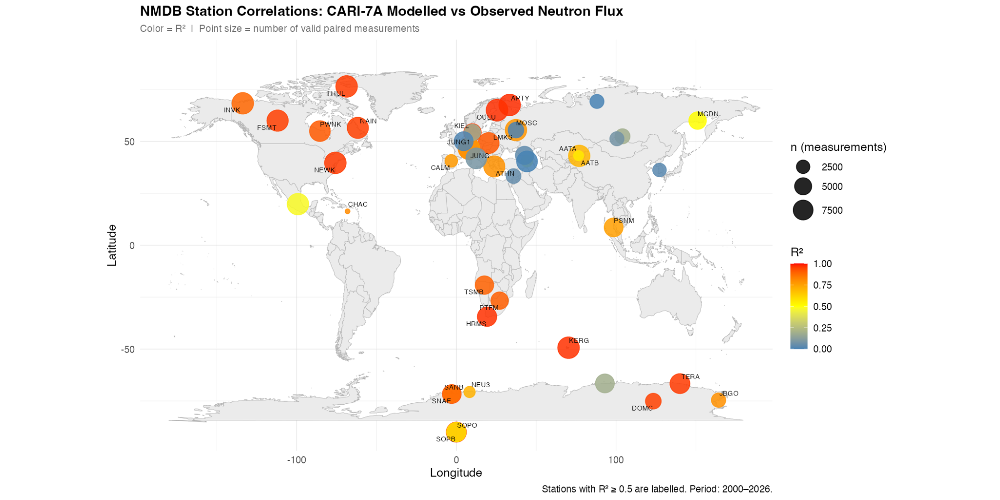

# Global Neutron Monitor Geospatial Analysis

**Independent research portfolio · Work in progress**  
*Python · R · Google Earth Engine · ERA5 · Geospatial Data Integration · Scientific Visualization*

*Author-produced exploratory map. Marker color encodes station-level linear-regression R² and marker size encodes the number of valid paired measurements. Correlation alone does not validate model accuracy.*

## Research motivation

How can geographically distributed neutron-monitor observations be integrated with gridded meteorological data and radiation-model outputs, and how do exploratory associations differ across locations?

This project combines **NMDB neutron-monitor station coordinates and time series**, **ERA5 meteorological variables extracted by geographic location using Google Earth Engine**, and exploratory comparisons with **CARI-7A** model outputs. It demonstrates practical GIS-related skills in georeferenced data extraction, spatial joins, coordinate validation and map visualization.

## Research skills demonstrated

- **GIS / geospatial data:** latitude/longitude validation, geographic point-based Earth Engine extraction, ERA5 atmospheric variables, global mapping in R using ggplot2 and maps.
- **Data engineering:** station metadata processing, CSV harmonization across years, missing-data checks, station/date/time-period alignment and linked data tables.
- **Statistical research:** matching CARI-7A records with station observations, station-level OLS/correlation summaries, R² analysis and visualization.
- **Scientific communication:** documented eight-stage pipeline, original world map and code notebooks with historical execution outputs.

The research README from the original project recorded 57 station codes, 49 with observations and 47 with both observations and coordinates. An **archived S7 notebook execution** reports 288,557 matched station-date rows across 47 stations. These figures are *historical outputs*, not independently recomputed for this repository.

## Workflow

| Step | Script / notebook | Purpose |
|---|---|---|
| S1 | `scripts/S1 Creating My Map.Rmd` | Validate latitude/longitude and map global stations |
| S2 | `scripts/S2 Merging Datasets.Rmd` | Merge annual NMDB CSVs and calculate station coverage |
| S3 | `scripts/S3 Meteorological data.ipynb` | Sample ERA5 at station points in Google Earth Engine |
| S4 | `scripts/S4 Merging Weather Data.Rmd` | Combine and aggregate meteorological observations |
| S5 | `scripts/S5 Adding hight into space data.Rmd` | Attach station altitude in the legacy wide-table format |
| S6 | `scripts/S6 Merging Weather and Space data.Rmd` | Join NMDB, ERA5 and location data |
| S7 | `scripts/S7 cari_analysis.ipynb` | Compare station observations and CARI output; calculate R² |
| S8 | `scripts/S8 World Map.Rmd` | Join R² to station coordinates and draw the map |

See [Workflow & Setup](docs/RESEARCH_WORKFLOW.md) for paths, handoffs, required files and commands. See [Data & Limitations](docs/DATA_AND_LIMITATIONS.md) for data provenance and methodological cautions.

## Setup and reproducibility status

Install Python packages with `pip install -r requirements.txt`. For R scripts, install `rmarkdown`, `here`, `readr`, `dplyr`, `tidyr`, `stringr`, `lubridate`, `ggplot2`, `maps`, `ggrepel`, and related tidyverse packages. 

**Raw NMDB, ERA5 and CARI input files are not distributed**. To rerun, obtain original source datasets under the providers' conditions, put station metadata and time series under `dataset/` as described in the workflow, and supply your own authenticated Google Earth Engine / Cloud Storage configuration. The S3 notebook is a portability-adjusted version of the original working notes; it has not been independently rerun here.

**This is an unfinished exploratory project**, not a verified one-command reproducibility package, causal study, structural economic-estimation project, or definitive physical validation. In-sample R² may reflect common temporal trends, differing data coverage and measurement units.

## Sources

- [NMDB / NEST](https://www.nmdb.eu/nest/) — neutron-monitor station observations
- [ERA5 Hourly / Google Earth Engine](https://developers.google.com/earth-engine/datasets/catalog/ECMWF_ERA5_HOURLY) — ECMWF/Copernicus atmospheric reanalysis; please acknowledge C3S/CAMS as required
- [FAA CARI-7 / CARI-7A](https://www.faa.gov/data_research/research/med_humanfacs/aeromedical/radiobiology/cari7) — radiation model
- Copeland (2017), [CARI-7A: Development and Validation](https://doi.org/10.1093/rpd/ncw369), *Radiation Protection Dosimetry*, 175(4), 419–431

## Author

**Conglin Bao** · [GitHub profile](https://github.com/RichardFranklinBAO)

Research methods and visualization are shown to document technical contributions without overstating an unfinished project's scientific findings.
